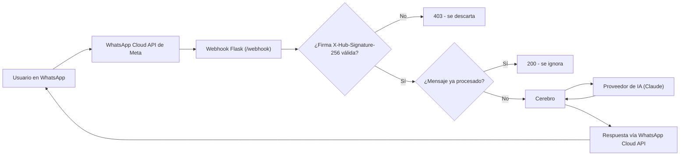

# BotWhatsApp

Asistente de WhatsApp con IA para pequeños negocios, demostrado aquí con un negocio ficticio: la **Panadería San Roque**.

## Demostración

### 1. Horario con fecha real

Responde con el horario real y calcula correctamente qué día es "mañana" (contexto de fecha, no una fecha inventada).


### 2. No inventa productos

No inventa un producto que no existe en el menú; ofrece alternativas reales en su lugar.


### 3. Domicilios

Responde sobre zonas de domicilio, costo y pedido mínimo con datos exactos del negocio.


### 4. Derivación a una persona

Ante una pregunta fuera de lo que sabe, lo admite y deriva la conversación a una persona del equipo.


### 5. Resistencia a manipulación

No revela sus instrucciones internas ni se desvía de su rol aunque se lo pidan directamente.


## Qué hace

- Responde preguntas frecuentes de un negocio por WhatsApp, basándose únicamente en su información (horarios, productos, precios, domicilios, medios de pago).
- Si no sabe la respuesta, lo dice con honestidad y deriva la conversación a una persona del equipo.
- Está diseñado para no inventar datos: responde solo con la información del negocio y, si no la tiene, lo dice.
- Mantiene contexto de fecha, hora y festivos colombianos (por ejemplo, para calcular "mañana" o si un día es festivo).
- Recuerda el historial reciente de cada conversación.
- Evita procesar un mismo mensaje más de una vez si Meta lo reenvía.

## Cómo funciona



Cuando llega un mensaje, el webhook valida la firma del envío, descarta duplicados y notificaciones de estado (entregado/leído), y entrega el texto a `Cerebro`. `Cerebro` arma un prompt con la información del negocio y el contexto de fecha/festivos, se lo pasa al proveedor de IA configurado, valida que la respuesta venga en el formato esperado, y decide si responder directamente o derivar la conversación a una persona. Una vez validada la firma, el webhook responde rápido con `200` a Meta, incluso si el envío de la respuesta falla, para evitar reintentos innecesarios.

## Seguridad

- **Verificación de firma**: cada notificación de Meta se valida con HMAC-SHA256 (`X-Hub-Signature-256`) sobre el cuerpo crudo de la petición, usando `hmac.compare_digest`. Sin firma válida, la petición se descarta sin procesarse.
- **Secretos solo en `.env`**: nunca en el código ni en el repositorio. `.env.example` documenta qué variables hacen falta, sin valores.
- **Logs sin datos sensibles**: nunca se registran tokens, secretos ni firmas; los números de teléfono se enmascaran (solo se ven los últimos 4 dígitos); los fallos de firma distinguen "ausente" de "no coincide" sin exponer ningún valor.
- **Deduplicación de mensajes**: cada mensaje de Meta trae un ID único; si ya se procesó, se ignora.
- **Respuestas acotadas a la información del negocio**: el bot está instruido para responder solo con la información de `negocio.md`, y las pruebas verifican que derive cuando no la tiene.
- **Resistencia a manipulación del prompt**: instrucciones explícitas y validación de la respuesta reducen el riesgo de que el bot revele su configuración interna o se salga de su rol (ver captura de demostración).
- **Mensajes de error sin fugas de configuración**: un valor inválido en una variable de entorno nunca aparece en el mensaje de error ni en los logs.
- **Permisos reforzados para herramientas de IA**: este repositorio incluye una regla en `.claude/settings.json` que impide leer `.env` por accidente al trabajar con Claude Code.

## Tecnologías

- Python 3.12
- Flask (servidor del webhook)
- [Anthropic Claude](https://www.anthropic.com) como proveedor de IA (modelo configurable vía `.env`)
- WhatsApp Cloud API (Meta)
- SQLite (historial de conversación y deduplicación de mensajes)
- pytest (pruebas automáticas)
- `holidays` y `tzdata` (festivos colombianos y zona horaria `America/Bogota`)

## Diseño reutilizable

Este repositorio es un **núcleo genérico**, pensado para adaptarse a distintos negocios sin tocar la lógica central:

- La información del negocio vive en un archivo de perfil (ver "Perfiles de negocio" abajo): para un negocio nuevo, solo se agrega un archivo.
- Las credenciales y la configuración viven en `.env`: para un cliente nuevo, solo cambia ese archivo.
- El proveedor de IA está detrás de una interfaz común (`llm/base.py`): hoy usa Claude, y está preparado para agregar otros proveedores sin cambiar `cerebro.py` ni `webhook.py`.

### Perfiles de negocio

El webhook elige qué información de negocio usar según la variable `PERFIL_NEGOCIO`, contra una lista cerrada de perfiles conocidos:

| Valor | Archivo | Uso |
| --- | --- | --- |
| *(vacío, por defecto)* o `panaderia` | `negocio.md` | Demo del proyecto (Panadería San Roque). |
| `camilo` | `perfil_camilo.md` | Presenta el servicio de Camilo a dueños de negocio interesados en contratarlo. |
| `tamales` | `perfil_tamales.md` | Demo para un negocio de tamales con domicilios (Tamales Tolimenses, ficticio). |

Un valor distinto a estos dos hace que el bot **falle al arrancar** con un mensaje claro, en vez de usar un perfil por defecto en silencio. Cada perfil nuevo requiere su propio despliegue (su propio número de WhatsApp), ya que un número solo puede atender un perfil a la vez.

### Mensajes enriquecidos

Además de texto, el bot puede compartir ubicación nativa de WhatsApp y botones con enlace (`cta_url`), según lo que tenga configurado cada perfil. Estos recursos viven en un archivo JSON propio por perfil (`recursos_panaderia.json`, `recursos_camilo.json`) que funciona como **lista blanca**: coordenadas, dirección y enlaces aprobados, cada uno con una clave (por ejemplo `"mapa"`). Ese JSON se valida al arrancar (coordenadas en rango, URLs `https`, textos dentro de los límites de WhatsApp) y falla con un error claro si algo está mal, igual que `PERFIL_NEGOCIO`.

La IA solo puede referirse a esos recursos por su clave, dentro del campo opcional `"adjuntos"` de su respuesta JSON — nunca puede inventar una URL, coordenada, clave o imagen. Si pide una clave que no existe en el perfil activo, ese adjunto se descarta y se registra en el log, pero la respuesta de texto se envía igual, sin fallar.

Las imágenes también se validan al arrancar (archivo existente, formato JPEG/PNG, tamaño ≤5 MB) y se suben a Meta solo cuando hace falta: el `media id` resultante se guarda en un caché dentro del volumen de datos (no en el repositorio) con su fecha de subida, y se resube automáticamente cuando falta o tiene más de 25 días. Si la subida falla, se registra (tipo y código de error, nunca el token) y la respuesta de texto se envía igual.

El bot también puede enviar botones de respuesta rápida (hasta 3) y listas (hasta 10 filas), con los mismos límites de WhatsApp verificados contra su documentación oficial. Un conjunto de botones (`"botones"` en `recursos_<perfil>.json`) es lista blanca igual que el resto: la IA solo puede pedir `{"tipo": "botones", "clave": "<clave>"}`. El menú (`{"tipo": "menu"}`) es distinto: se arma **por código**, directamente desde `"catalogo"`, así que la IA nunca decide qué productos o precios aparecen ahí.

### Toma de pedidos

Cuando el cliente elige un producto del menú (o toca el botón "Hacer pedido"), la conversación entra a un **modo de pedido determinista**: a partir de ahí, cada mensaje lo maneja `flujo_pedido.py` por código — `cerebro.py` (la IA) deja de participar por completo hasta que el pedido se confirma, se cancela o se agota el tiempo. Esto es intencional: un pedido con dinero de por medio no puede depender de que la IA calcule ni redondee nada.

El flujo cubre, en orden: elegir productos (con botones "Agregar otro"/"Continuar" para pedir varios) → tipo de entrega (domicilio o recoger en el local). Si es domicilio: valida el pedido mínimo, **solo entonces** pide el consentimiento de datos (Ley 1581) — recoger en el local nunca lo pide, porque no hace falta guardar ninguna dirección — y si el cliente no acepta, no cancela: ofrece `[Recoger en el local] [Cancelar]` en su lugar. Si acepta, sigue con la zona (de una lista) y la dirección (por texto o compartiendo la ubicación). El resumen y el mensaje final de confirmación muestran la zona y la dirección exactas (o "ubicación compartida por WhatsApp" si el cliente compartió su ubicación en vez de escribirla), con el total **siempre calculado desde `"catalogo"` y `"domicilio"`**. También maneja salidas en cualquier punto: palabras clave para cancelar o pedir una persona (sin distinguir mayúsculas ni tildes), 30 minutos sin respuesta cancelan el pedido en construcción, y ante una entrada que no se reconoce reenvía el mismo paso (los mismos botones, la misma lista o el mismo resumen) en vez de un mensaje genérico, para que el cliente no pierda lo ya elegido.

Los pedidos se guardan en la misma base SQLite (`pedidos.py`, tablas `pedidos` y `pedido_items`), con un número de pedido autoincremental y un solo pedido activo por número de cliente (en construcción, con el pago pendiente, o con el pago en verificación).

### Pago asistido

Al tocar "Confirmar", el bot pregunta cómo desea pagar: **efectivo** (el pedido queda confirmado de inmediato, con pago contra entrega o al recoger) o **QR / transferencia** (envía la imagen del QR de ejemplo con el valor exacto y el número de pedido como referencia, y pide el comprobante). El valor a pagar siempre sale del total ya calculado por código — nunca de la IA ni de un texto del cliente.

Cuando el cliente envía la foto del comprobante, el pedido pasa a verificación y, si está configurada la variable `NUMERO_DUENO`, el bot le reenvía al dueño el comprobante (descargado y vuelto a subir en memoria, sin escribir nada a disco ni a la base de datos — la documentación oficial de Meta no ofrece una forma de reenviar un media id entrante directamente) junto con botones `[Pago recibido] [No ha llegado]`. Solo un mensaje que llegue exactamente de ese número puede confirmar o rechazar un pago; cualquier otro mensaje del dueño (un "hola", un botón que ya no aplica) recibe un recordatorio fijo de que ese es el número del negocio, sin pasar nunca por la IA ni por el flujo de pedidos. Si ese aviso falla (por ejemplo, por la ventana de 24 horas de WhatsApp sin un mensaje previo del dueño), se registra una advertencia y el pedido queda igual en verificación — al cliente nunca le llega ese error.

Como respaldo (o si `NUMERO_DUENO` no está configurada), `gestionar_pedido.py` permite listar los pedidos en espera y confirmar o rechazar un pago desde la línea de comandos dentro del contenedor:

```bash
docker compose exec bot-whatsapp python gestionar_pedido.py listar
docker compose exec bot-whatsapp python gestionar_pedido.py confirmar <numero_de_pedido>
docker compose exec bot-whatsapp python gestionar_pedido.py no-llego <numero_de_pedido>
```

El script enmascara siempre el teléfono del cliente y pide una confirmación explícita antes de aplicar el cambio. Las palabras clave para cancelar o pedir una persona siguen funcionando durante el pago, salvo que ya se envió un comprobante: ahí "cancelar" ya no cancela (hay dinero en camino) y, junto con "asesor", solo deriva a una persona sin tocar el estado del pedido. El timeout de 30 minutos tampoco aplica mientras se espera un pago.

**Logging bajo gunicorn:** `gunicorn.conf.py` (cargado con `--config` desde el `CMD` del Dockerfile) configura el logging en cada worker (`post_fork`), para que los eventos de `webhook.py`, `flujo_pedido.py` y `pago_pedido.py` (p. ej. "Pedido #7 confirmado", "mensaje antiguo ignorado") se vean con `docker compose logs`. El log de accesos propio de gunicorn está desactivado para no duplicar la línea que ya registra `webhook.py` por cada petición (método, ruta sin cadena de consulta, código de estado) — esa línea nunca incluye el verify token de Meta, y las peticiones a `/salud` del healthcheck no se registran. Los eventos de la aplicación nunca incluyen el número de teléfono completo (solo los últimos 4 dígitos, vía `telefono.py`), el texto de los mensajes, direcciones, ubicaciones ni el contenido de un comprobante de pago — solo el hecho de que algo pasó.

### Créditos de fotos

| Archivo | Crédito |
| --- | --- |
| `tortas2.jpg` | Foto de Unsplash (licencia Unsplash) |

Estas son fotos de demostración, de uso libre, elegidas solo para mostrar la funcionalidad. En un despliegue real para un cliente, se reemplazan por fotos propias del negocio (su pan, sus tortas, su vitrina), definidas en su propio `recursos_<perfil>.json`.

Claves de imagen propuestas para cuando el negocio tenga sus propias fotos: `pandebono`, `almojabana`, `pan_rollo` (o `pan_alinado`), `roscon`, `torta_chocolate` (en uso), `tres_leches`, `vitrina` y `pan_del_dia`.

`recursos/demo/qr_ejemplo.png` (perfil `tamales`) no es una foto: es una imagen generada con Pillow para la demo, con el texto "QR DE EJEMPLO - NO PAGAR" bien visible. Nunca se usa un QR de pago real (ni de Bold ni de ningún otro medio) en este repositorio.

## Estructura del proyecto

```
BotWhatsApp/
├── .env.example                   # Plantilla de variables de entorno (sin valores)
├── .claude/settings.json          # Regla de permisos: impide leer .env por accidente
├── requirements.txt
├── pytest.ini
├── negocio.md                     # Información del negocio (editable sin tocar código)
├── env.py                         # Helper para leer variables de entorno (con strip)
├── historial.py                   # Interfaz Historial + HistorialMemoria (para pruebas)
├── almacenamiento.py              # HistorialSQLite: historial y deduplicación de mensajes
├── llm/
│   ├── base.py                    # Interfaz ProveedorIA
│   ├── claude.py                  # Implementación con el SDK oficial de Anthropic
│   ├── openai_proveedor.py        # Placeholder para un futuro proveedor OpenAI
│   └── __init__.py                # Función fábrica según PROVEEDOR_IA
├── cerebro.py                     # Prompt, contexto de fecha/festivos, validación de respuesta
├── recursos.py                    # Valida el JSON de recursos (ubicación, enlaces, catálogo...) de cada perfil
├── recursos_panaderia.json        # Lista blanca de recursos del perfil "panaderia"
├── recursos_camilo.json           # Lista blanca de recursos del perfil "camilo"
├── recursos_tamales.json          # Lista blanca de recursos del perfil "tamales"
├── perfil_camilo.md               # Información del perfil "camilo"
├── perfil_tamales.md              # Información del perfil "tamales"
├── simulador.py                   # REPL de consola para probar sin WhatsApp
├── webhook.py                     # Servidor Flask: verificación, firma, deduplicación, envío
├── whatsapp.py                    # Envío de mensajes de texto vía WhatsApp Cloud API
├── mensajes_enriquecidos.py       # Envío de ubicación, botón con enlace (cta_url), imágenes, botones y listas
├── media_cache.py                 # Sube imágenes a Meta y cachea su media id (vence a los 25 días)
├── pedidos.py                     # Persistencia de pedidos en SQLite (tablas pedidos y pedido_items)
├── flujo_pedido.py                # Máquina de estados de la toma de pedidos y el pago (sin IA, sin Flask)
├── pago_pedido.py                 # Confirmar/rechazar un pago en verificación (compartido webhook/script)
├── gestionar_pedido.py             # CLI de respaldo: listar y confirmar pagos dentro del contenedor
├── telefono.py                    # Enmascarado/normalización de número de teléfono
├── gunicorn.conf.py                # Logging de gunicorn (stdout; accesslog propio desactivado)
├── verificar_config.py            # Verifica que .env tenga las variables, sin exponer valores
├── verificar_suscripcion_waba.py  # Diagnóstico: apps suscritas a la cuenta de WhatsApp
├── suscribir_app_a_waba.py        # Suscribe esta app a la cuenta de WhatsApp
├── docs/capturas/                 # Capturas de pantalla de este README
└── tests/                         # Pruebas automáticas (pytest)
```

## Instalación y uso

En Windows (PowerShell):

```powershell
git clone <url-del-repositorio>
cd BotWhatsApp
python -m venv venv
venv\Scripts\Activate.ps1
pip install -r requirements.txt
copy .env.example .env         # Luego completa .env con tus propios valores
python verificar_config.py     # Confirma qué variables tienen valor, sin mostrarlas
python simulador.py            # Probar el "cerebro" del bot por consola, sin WhatsApp
python webhook.py              # Levantar el servidor del webhook
```

En Linux/macOS:

```bash
git clone <url-del-repositorio>
cd BotWhatsApp
python -m venv venv
source venv/bin/activate
pip install -r requirements.txt
cp .env.example .env           # Luego completa .env con tus propios valores
python verificar_config.py
python simulador.py
python webhook.py
```

Configuración del lado de Meta (resumen, sin IDs ni valores reales):

1. Crear una app en el panel de desarrolladores de Meta y agregar el producto de WhatsApp.
2. Obtener un número de prueba (o conectar un número propio) y su identificador.
3. En **Casos de uso → Conectarte con los clientes a través de WhatsApp → Configuración**, registrar la URL del webhook y el token de verificación, y suscribirse al campo `messages`.
4. Suscribir la app a la cuenta de WhatsApp Business (WABA) — sin esto, los mensajes reales no llegan al webhook aunque las pruebas del panel funcionen.
5. Para producción, generar un token de un usuario del sistema (con permisos de mensajería y administración de WhatsApp) en vez de usar el token temporal de prueba.

## Pruebas

```bash
pytest
```

El proyecto tiene **240 pruebas automáticas**, todas sin red real: simulan el proveedor de IA y el envío por WhatsApp, y usan bases de datos temporales para el historial, la deduplicación y los pedidos.

## Despliegue con Docker

Requisitos: Docker y Docker Compose instalados.

```bash
cp .env.example .env     # Completa .env con tus propios valores
docker compose up -d --build
```

Verificar que el servicio quedó arriba:

```bash
curl http://127.0.0.1:8000/salud   # Debe responder "ok"
docker compose ps                  # Debe mostrar "healthy"
```

Ver los logs:

```bash
docker compose logs -f bot-whatsapp
```

Actualizar tras un cambio de código:

```bash
docker compose up -d --build
```

El contenedor corre como usuario sin privilegios, con el sistema de archivos en modo solo lectura (salvo `/tmp` y el volumen de datos), y publica el puerto únicamente en `127.0.0.1` — para exponerlo a internet hace falta un proxy inverso con su propio dominio y TLS (no incluido aquí). La base de datos SQLite vive en un volumen nombrado de Docker, independiente del código de la imagen.

## Limitaciones y próximos pasos

- El túnel usado en desarrollo (Cloudflare Quick Tunnel) es temporal y cambia de URL en cada reinicio; en producción el webhook debe vivir en un servidor con dominio propio.
- La app de Meta sigue en modo desarrollo: los destinatarios están limitados a los números de prueba registrados.
- Posibles módulos futuros, sin tocar el núcleo: integración con un CRM en Google Sheets, recordatorios de pago, y un panel de administración para que el negocio edite su propia información.

## Autor

**Camilo Andrés Uribe Gaona** — Ingeniero de Sistemas, auditor interno ISO/IEC 27001:2022.

[LinkedIn](https://www.linkedin.com/in/camilo-uribe-gaona)

Desarrollado con apoyo de Claude Code.
